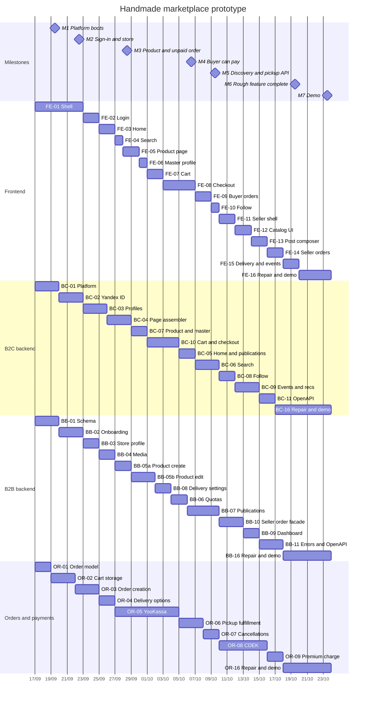
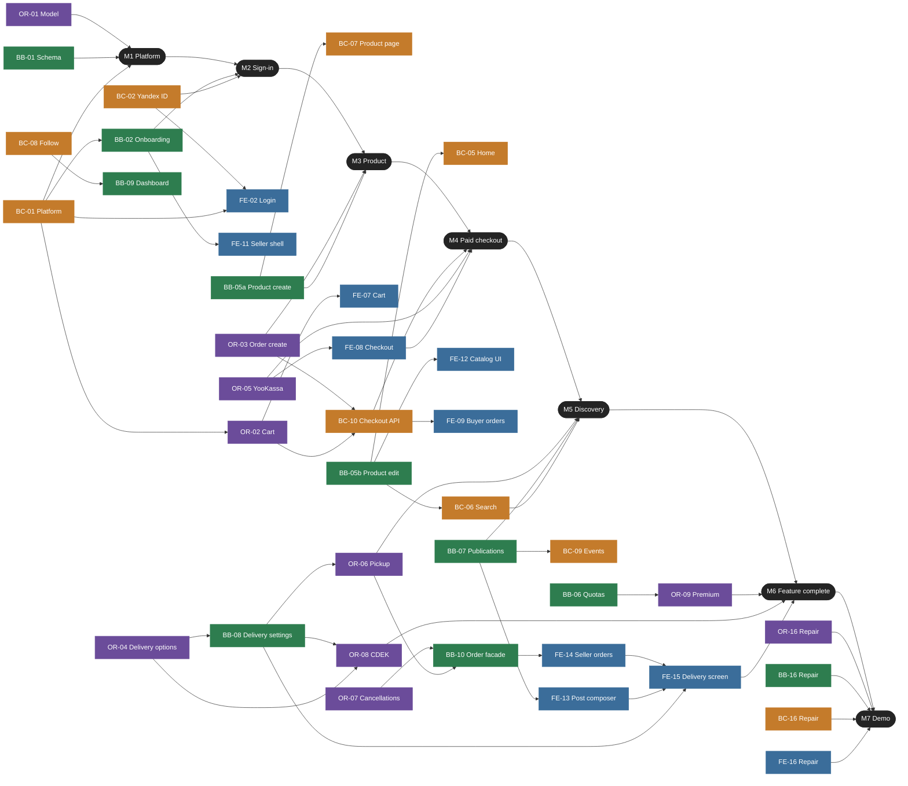

# Handmade marketplace prototype

17 September through 23 October 2026, every day. Bar color is the owner. Dates on the axis are day/month. The Gantt chart does not draw arrows, so the cross-team waits and the milestone gates are in the second diagram. Work that stays inside one owner follows the bar order in that section.

## Dependencies

An arrow means the target cannot finish its job until the source is done. Same-owner sequences are left off this chart. They are the consecutive bars in each Gantt section.

